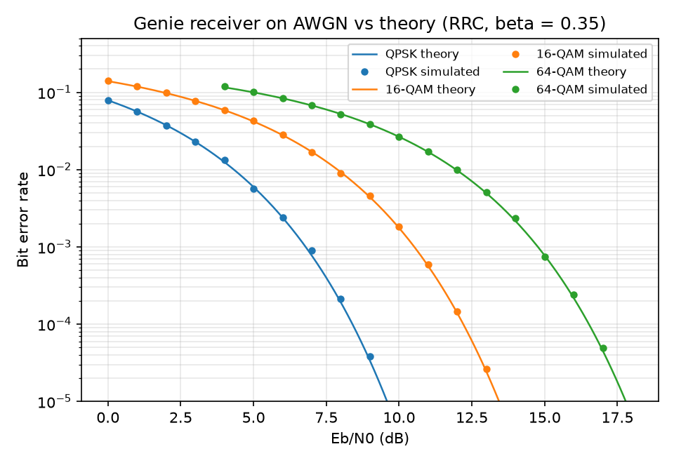
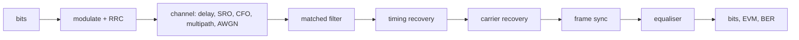

# wireless-rx-dsp

**A digital wireless receiver built from scratch in Python (timing, carrier, frame sync, equalisation), extended to OFDM, plus an FMCW automotive-radar processing chain.**

<!-- HERO FIGURE (add in W06): four constellations side by side —
     raw received → after timing recovery → after carrier recovery → after equaliser -->

[](https://github.com/sohui-lee-HH/wireless-rx-dsp/actions/workflows/ci.yml)

## What's inside

Every phone, Wi-Fi chip, 5G base station and car radar contains the same core problem: the received signal arrives with the wrong timing, the wrong frequency, an unknown start and echoes from the environment, and the receiver has to undo all of it before a single bit can be read. Libraries and SDR toolkits usually hide these steps. I wanted to build each one myself, so this repo implements the receiver block by block and checks every block against what theory says it should achieve.

The same toolbox (FFTs, correlation, filtering) also runs an FMCW radar, which is why the project ends with range-Doppler processing. The receiver then becomes the device under test in my next project, an automated RF validation bench, which verifies it against the specification in `docs/receiver_spec.md`.

| Channel impairment | Receiver block | Result | Status |
|---|---|---|---|
| Noise (AWGN) | Matched filter, genie timing | BER on the theory curve | ✅ |
| Timing offset, sample-rate drift | Gardner timing recovery | Eye re-opened, drift tracked | ⬜ 03 |
| Carrier frequency offset | Coarse FFT estimate + Costas loop | Constellation de-rotated | ⬜ 04 |
| Unknown burst start | Zadoff-Chu preamble + correlator | Frame located | ⬜ 05 |
| Multipath (ISI) | LMS and blind CMA equalisers | ISI removed | ⬜ 06 |
| Frequency-selective channel | OFDM: CP sync, pilot channel estimation | EVM per subcarrier | ⬜ 07 |
| — | FMCW radar: range-Doppler, CA-CFAR, angle FFT | Targets detected | ⬜ 08 |

## Results

### Baseline: genie receiver vs theory



With ideal synchronisation the simulated BER sits on the theoretical curves for QPSK, 16-QAM and 64-QAM. This is the reference: each later block is judged by how closely it brings an impaired signal back to this curve.

<!-- 05: BER with all impairments on vs theory, and the implementation loss in dB -->
<!-- 07: OFDM EVM per subcarrier on a multipath channel -->
<!-- 08: range-Doppler map with CFAR detections -->

## Architecture



The whole receiver is one object, so other code (including the test bench in Project 3) can drive it:

```python
from wireless_rx_dsp import Receiver, RxConfig

rx = Receiver(RxConfig(M=16, sps=8))
result = rx.process(iq, n_symbols=1000)   # result.bits, result.symbols, result.cfo_hz, ...
```

## Receiver specification

[`docs/receiver_spec.md`](docs/receiver_spec.md) states the receiver's requirements (sensitivity, EVM, BER, offset ranges). They are verified automatically in Project 3, [rf-test-bench](https://github.com/sohui-lee-HH/rf-test-bench). 

## Quickstart

```bash
git clone https://github.com/sohui-lee-HH/wireless-rx-dsp.git
cd wireless-rx-dsp
conda env create -f environment.yml
conda activate wrx
pytest
python experiments/00_baseline_ber.py
```

Or with plain pip: `pip install -e ".[dev]"`.

## Repository layout

```
src/wireless_rx_dsp/
├── tx/          constellation mapping, RRC pulse shaping
├── channel/     AWGN and impairments
├── rx/          matched filter, timing, carrier, frame sync, equaliser, Receiver
├── ofdm/        OFDM modem, CP synchronisation, channel estimation
├── radar/       FMCW simulation, range-Doppler, CFAR, angle estimation
└── metrics.py   BER, EVM, theoretical curves
experiments/     one script per figure in this README
tests/           known-answer tests for every block
docs/            receiver spec, figures
```

## Related work

Builds on [iqmodrec](https://github.com/sohui-lee-HH/iqmodrec), my CNN modulation classifier, and reuses its modulators.

## Design notes and limitations

<!-- Fill in as you go: choices you made (loop bandwidths, why Gardner over Mueller-Müller,
     why a ZC preamble), what you measured, and what is out of scope (e.g. no channel coding). -->

## License

MIT
